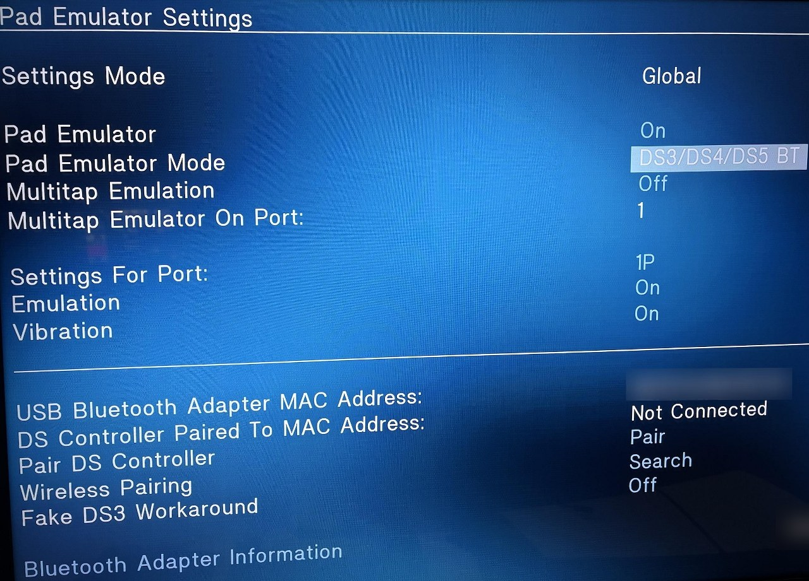
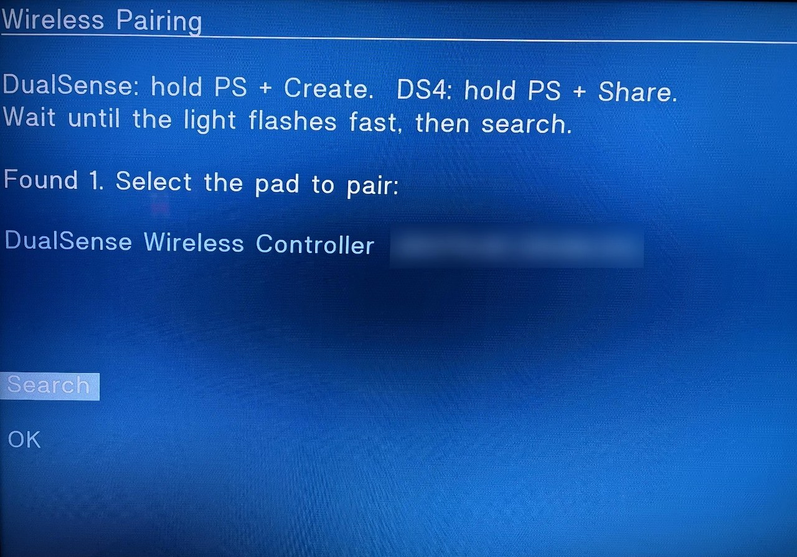

# OPL-DualSense-BT

A fork of [Open PS2 Loader](https://github.com/ps2homebrew/Open-PS2-Loader) that lets you play your PS2 with a **DualSense over Bluetooth**. No cable from the couch to the console.

## What's new

- **DualSense over Bluetooth**, both in the OPL menu and in-game. Buttons, sticks, rumble and lightbar all work.
- **Wireless pairing from the OPL menu.** New `Wireless Pairing → Search` button: put the pad in pairing mode, pick it from the list, done. No USB cable, no PC.
- **USB pairing for the DualSense** too, with the same `Pair` button OPL already had for the DS3/DS4.
- Everything that already worked (DS3, DS4, USB pairing) works exactly like before.

Under the hood it's three things the DualSense needed and stock OPL doesn't have:
- its own input/output reports, including the CRC32 that output reports need;
- a tiny SDP server, because the pad asks the console what services it has and drops the link after ~30 s if nobody answers;
- Secure Simple Pairing for the wireless search, with a link key stored per pad.

## Getting started

Grab `OPNPS2LD.ELF` from the [Releases](../../releases) page and launch it however you usually launch OPL (FreeMcBoot, uLaunchELF, a modchip, whatever). It's a regular OPL, so your games and settings work as usual.

You need a **USB Bluetooth dongle** plugged into the PS2 (see [Compatibility](#compatibility)).

### 1. Turn on the pad emulator

- **For all games:** `Start → Controller Settings → Configure PADEMU`
- **For a single game:** select the game, press `Triangle`, then go to `Configure PADEMU`

Then set:
- `Pad Emulator` → **On**
- `Pad Emulator Mode` → **DS3/DS4/DS5 BT**
- `Settings For Port` → pick the port (1P, 2P...) and turn on `Emulation` (and `Vibration` if you want rumble)



Don't forget `Save Changes`. If you skip it, the game launches without the emulator and you'll swear the pad is broken (been there).

### 2. Pair the pad (only once)

**Wireless (recommended):**
1. In the same PADEMU screen, go to `Wireless Pairing → Search`.
2. Hold **PS + Create** on the DualSense until the light blinks fast (DS4: **PS + Share**).
3. Your pad shows up in the list. Select it and wait for `Paired and saved`.

**P.S.:** Wireless pairing is only supported for the DS4 and DS5 controllers.



**With a cable:**
1. Plug the DualSense into the PS2 with a USB cable (dongle in the other port).
2. Press `Pair`, unplug the cable and press PS.

The pairing is saved, so you don't have to do it again. Next time just press PS.

### 3. Play

Launch the game and press **PS** on the pad once the game is on screen. Launching a game resets the PS2's USB side, so the pad always disconnects for a second and needs that PS press to come back. Reconnecting takes a fraction of a second.

## Compatibility

Honestly, it's only been tested on one setup so far. Everything else comes from how the code works, not from real testing. If you try it, please report back (see below).

### Tested 

| What | Model |
|---|---|
| Console | PS2 Slim SCPH-90001 (Matrix modchip) |
| Dongle | Realtek, USB ID `0BDA:8771` |
| Controller | DualSense (wireless pairing, USB pairing, menu and in-game) |
| Mixed | DualSense on 1P via Bluetooth + wired DualShock 2 on 2P |

### Should work 

- **Any PS2 that runs OPL** (fat or slim). There's nothing model-specific in here.
- **Dongles:** most USB Bluetooth adapters that don't need firmware loaded by the OS. CSR8510-based ones are the classic pick for PADEMU. The wireless search needs **Bluetooth 2.1 or newer**. USB pairing works with older dongles too.
- **DualSense Edge:** same reports as the regular one and it's recognized by name, but nobody has tried it yet.
- **Original DualShock 4** (both CUH-ZCT1 and ZCT2): USB pairing already worked in stock OPL, and the wireless search uses the same pairing method as the DualSense.

### Probably won't work / unknown 

- **Dongles that need firmware uploaded** (some Intel and Broadcom ones) and **BLE-only dongles**.
- **Cheap clone CSR dongles:** a coin toss.
- **Fake DS4s:** depends on the clone. Some don't accept the USB pairing command, some only do old PIN pairing (the wireless search doesn't handle that yet), and some show up with a different Bluetooth name and get treated like a DS3.

### Limitations

- In the **OPL menu**, only one Bluetooth pad is used. **In-game** the driver supports up to 4, but only one has been tested so far.
- Up to **4 pads** paired with the wireless search are remembered. Pairing a 5th forgets the oldest one.
- Some games just don't like PADEMU (games with their own pad drivers, or that use USB for something else). That's the same as stock OPL.
- On a fat PS2 with HDD + VMC + cheats all on, some games may run out of IOP memory. That's also a stock OPL thing; this fork only adds a few hundred bytes.

### Report your setup

Open an [issue](../../issues) with:
- PS2 model (e.g. SCPH-90001)
- Dongle (brand, and the USB ID if you can get it: `xxxx:xxxx`)
- Controller (DualSense, Edge, DS4 original/clone...)
- What worked: USB pairing / wireless search / menu / in-game

If something's broken, a log helps a ton (see the next section).

## Debug build and logs

There's a `dualsense-bt-debug` branch that sends logs over the network. To use it:

1. Connect the PS2 to your router with an Ethernet cable and set its IP in OPL's network settings.
2. On your PC (same network), run `python tools/ps2_log.py`. It listens on UDP port 18194 and saves everything to `ps2_log.txt`.
3. Launch the debug ELF, reproduce the problem and attach `ps2_log.txt` to your issue.

## Building

Same as regular OPL: you need [ps2dev/ps2sdk](https://github.com/ps2dev/ps2dev) set up (`PS2DEV` and `PS2SDK` exported), then:

```sh
make download_lng
make            # release
make DEBUG=1 INGAME_DEBUG=1   # debug build with network logs
```

See [README-OPL.md](README-OPL.md) for the full upstream docs (game formats, devices, settings and so on).

### Where the changes live

- `modules/ds34bt/iop/ds34bt.c`: Bluetooth driver for the OPL menu (DualSense support, SDP, wireless search and pairing)
- `modules/pademu/ds34bt.c`: in-game Bluetooth driver
- `modules/ds34usb/iop/ds34usb.c`: USB pairing for the DualSense
- `include/btkeys.h`: per-pad link keys for wireless pairing
- `src/guigame.c`, `src/dialogs.c`: the `Wireless Pairing` screen

## Credits

- The [Open PS2 Loader](https://github.com/ps2homebrew/Open-PS2-Loader) team and everyone behind PADEMU. This is 99% their work.
- The Bluetooth driver is based on [Arduino-PSRemote](https://github.com/IonAgorria/Arduino-PSRemote) and the [USB Host Shield 2.0](https://github.com/felis/USB_Host_Shield_2.0) library, same as upstream.

## License

Same as OPL: [Academic Free License v3.0](LICENSE).
